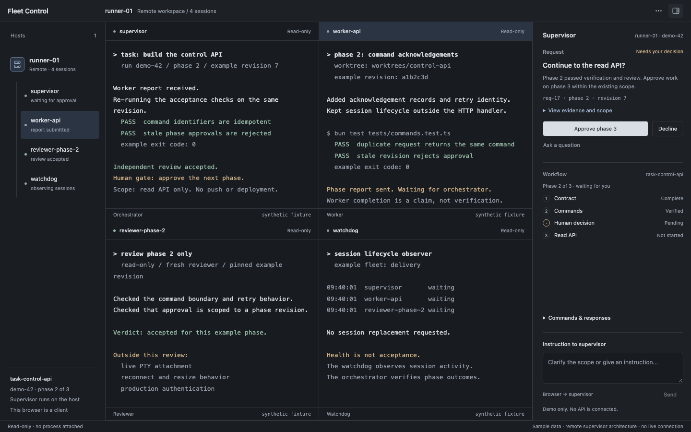

# Fleet Control

Fleet Control is a self-hosted web console for people running coding agents in tmux. From one browser window, you can watch a session, send an instruction to its supervisor, and answer a request for approval. [agent-fleet](https://github.com/kolezka/agent-fleet) runs the sessions on each workstation. Fleet Control gives you a view across them without moving the work to your laptop.

[Try the demo](#quick-start-two-local-hosts) · [Connect a workstation](#connect-your-own-workstation) · [Multi-host setup](docs/multi-host.md) · [Implementation status](docs/implementation-status.md)



*Design preview with synthetic data. To explore the layout without installing anything, open the [standalone HTML preview](docs/design/terminal-deck.html) from a local checkout.*

## Quick start: two local hosts

Try the multi-host console on one machine before connecting a workstation. The demo starts two local services, each with its own private tmux socket, shell fixture and SQLite database. It does not start a model or require an API key or PostgreSQL.

**Requirements:** Git, Bun 1.4 or newer, tmux 3.x and Bash 4 or newer on your `PATH`. On macOS, make sure `bash --version` in the shell that starts the demo reports the newer Bash, not the system Bash 3.2.

```sh
git clone --recurse-submodules https://github.com/kolezka/fleet-control.git
cd fleet-control
bun install --frozen-lockfile
env -u NO_COLOR bun run demo:two-hosts
```

1. Leave the demo running. In a second terminal, enter the same checkout and run the `FLEET_CONTROL_CLIENT_CONFIG=... bun run client` command printed by the demo. The generated config points to this run's temporary hosts.
2. Open **<http://127.0.0.1:4870/>**. Select `probe-shell` under `alpha`, then under `beta`. Look for `HOST-ALPHA-TERMINAL` and `HOST-BETA-TERMINAL`: the sessions have the same name, but you are viewing different hosts.
3. Open the supervisor panel. Each host has its own sample approval request. Answering one records a decision for that host; it does not execute a phase. The demo shells echo input rather than interpret it as a command.
4. Press **Ctrl+C** in the client terminal, then in the demo terminal. Stopping the demo removes its temporary fleets, databases and credentials.

If startup reports a missing `fleet` or `watchdog.sh`, run `git submodule update --init --recursive` in the checkout. Run it again after pulling updates to use the version of agent-fleet pinned by this repository.

## Connect your own workstation

Run the **host service** where the tmux sessions live, as the user who owns the fleet. Start with a test fleet. Use its existing agent-fleet `fleet.conf`, and choose a private directory for persistent state:

```sh
mkdir -p -m 700 "$HOME/.local/state/fleet-control"
env -u NO_COLOR \
  FLEET_CONF="/absolute/path/to/your/fleet.conf" \
  FLEET_CONTROL_DB="$HOME/.local/state/fleet-control/host.sqlite" \
  bun run serve
```

Replace the example config path before running. Open **<http://127.0.0.1:4871/>** on the workstation and select a session. The service uses an in-memory database if you omit `FLEET_CONTROL_DB`; set it if you need command history and decisions after a restart. Clearing `NO_COLOR` matters because agent-fleet uses prompt styling to distinguish a suggestion from someone typing.

**For access from a laptop**, follow the [host installation guide](docs/install-guide.md) to configure authentication and TLS, then the [gateway guide](docs/multi-host.md) to create your client config. Use a separate operator token for each host, keep token files outside Git, and use HTTPS with a trusted certificate for remote connections. The local gateway holds those credentials on behalf of the browser. Run it only on a machine whose local users and processes you trust.

```sh
FLEET_CONTROL_CLIENT_CONFIG="$HOME/.config/fleet-control/client.json" bun run client
```

## Working in the console

- **Watch a session.** Select a host in the left sidebar, then a session to focus its terminal. A configured model is not necessarily the model that ran; see [model observation](docs/model-observability.md) for how to read the label.
- **Give an instruction.** Use the supervisor panel for work you want tracked. A queued command has been recorded, and a delivered command has been sent. Neither means the agent has accepted or finished it. If a connection drops, inspect the existing command before sending it again.
- **Review a decision.** Check the host, request, phase and revision before approving. An approval records your decision about that revision, not proof that the next phase started. Closing the browser does not approve pending work or stop agents already running on a workstation.
- **Take direct control when needed.** Terminals are read-only by default. A host can opt into operator-only typing under an exclusive input lease. Managed agent launches and fleet administration are separate opt-ins; you do not need to enable them to watch a fleet.

## Choose the right setup

| What you need | What to run | Guide |
| --- | --- | --- |
| Inspect or supervise one fleet | A host service beside agent-fleet, with SQLite for persistent history | [Host setup](docs/install-guide.md) |
| See several workstations in one Terminal Deck | One host service per workstation and a loopback client gateway on your laptop | [Gateway configuration, TLS and per-host MCP](docs/multi-host.md) |
| Let supervisors claim work and report progress through MCP | Optional cooperative central service with PostgreSQL and a supervisor adapter | [Cooperative deployment](deploy/cooperative/README.md) |

The cooperative service is a separate command path, not a prerequisite for the console. A claim reserves work; it is not an execution report. If you map a gateway command panel to central, its terminals still come from the host service, and approvals and workflow are unavailable in that mapped panel. See [cooperative command routing](docs/multi-host.md#optional-cooperative-central-commands) before enabling it.

## Development and operations

- [Installation CLI](docs/install-cli.md): preview a fresh installation plan before applying it to a prepared checkout.
- [Implementation status](docs/implementation-status.md): distinguish implemented features, tested scenarios and open limits before connecting production sessions.
- [Source layout](docs/source-layout.md): find the entry points, application logic and storage layers.
- Run `bun run typecheck` for types and `bun run design:check` for the standalone preview's event handlers. The full `bun test` suite includes real tmux tests and optional PostgreSQL integration tests. Use an isolated development environment and a disposable test database, never an operational database.
